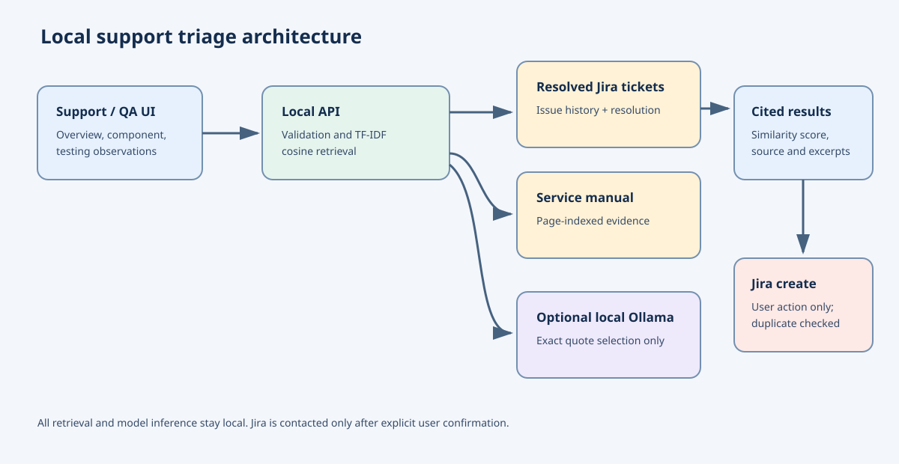
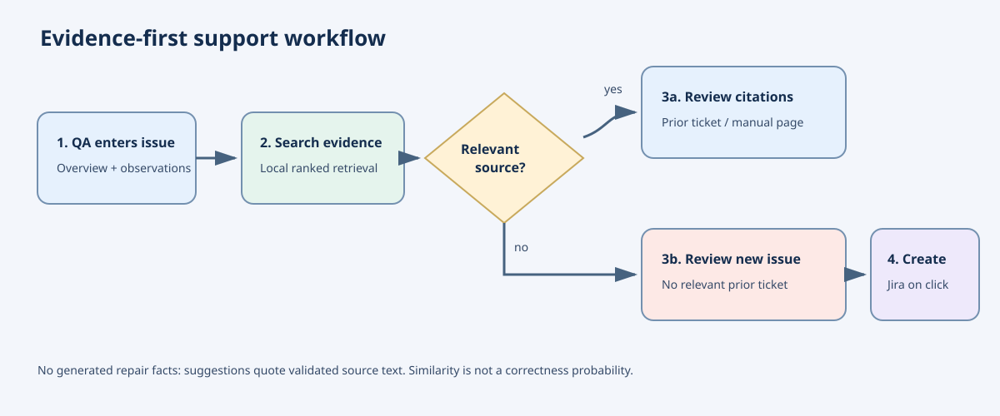

# Washing-machine support triage (local prototype)

An evidence-first prototype for checking a QA/support query against resolved
Jira examples and a service manual before an agent creates a new Jira issue.
It binds to `127.0.0.1`, requires no cloud services, and has no model dependency.

## Run it

```bash
python3 scripts/generate_data.py
python3 app/server.py
```

Open <http://127.0.0.1:8000>. Try “drum does not drain, E21, filter clear”.
The sample Jira records and service manual are fictional. The generator creates
`data/service_manual.pdf` with exactly 200 pages and a page-indexed JSON file
used by the prototype. Python 3.10+; core app and generator use only the standard
library. Run checks with `python3 -m unittest discover -s tests`.

To run a deterministic end-to-end batch against the live HTTP API and save all
10 requests and responses, run:

```bash
python3 scripts/run_demo.py
```

Inputs are in `data/demo_queries.json`; captured API output is in
`data/demo_responses.json`. The demo starts and stops its own local server and
forces extractive mode so the saved responses are repeatable.

## Diagrams





### Optional local model

Install Ollama separately, pull a small instruction model that fits the machine
(for example `qwen2.5:3b` with a quantized build), then start the app as:

```bash
OLLAMA_MODEL=qwen2.5:3b python3 app/server.py
```

The app sends only the current query and the top evidence snippets to the local
Ollama `/api/generate` endpoint. Its only allowed output is exact quotes from
those snippets. The server verifies each quote against the source before
displaying it; invalid output is discarded and the UI shows the reason while
retaining extractive suggestions. The model call has a 3-second timeout. With
no configured model, search remains fully functional and suggestions are
extractive. The model is not allowed to create or alter service instructions.

## Brief architecture / flow

```text
Support/QA browser
  -> local HTTP UI/API (127.0.0.1)
  -> query + component/observations
  -> local TF-IDF cosine retrieval over resolved tickets + manual page chunks
  -> ranked evidence: similarity %, source ID, Jira URL or manual page citation
  -> extractive resolution suggestions (optionally quote-selected by local model)
  -> agent reviews evidence
  -> only when no relevant prior ticket: explicit Jira create action
  -> Jira Cloud REST API (only when Jira credentials are configured)
```

The prototype does not auto-close a query or auto-create a Jira issue. It
surfaces ranked evidence and leaves the decision to QA. The relevance percentage
is a retrieval similarity, **not** a probability of correctness. A suggestion's
groundedness is 100% only when its displayed text is verified as an exact source
quote. “Accuracy” must be established separately against labeled QA cases; it
is not inferred from the similarity score.

## Jira and latency

Creating an issue is disabled until all of these are set: `JIRA_BASE_URL`
(for example `https://example.atlassian.net`), `JIRA_PROJECT_KEY`,
`JIRA_EMAIL`, and `JIRA_API_TOKEN`. Credentials are read from the process
environment and are never stored in the repository. Creation is initiated only
by the UI action, and any relevant existing Jira candidate blocks creation. The
prototype uses Jira's REST API v3 and creates a Bug with the entered overview,
component, and testing observations in the description.

The intended interactive budget is <10 seconds on a 32 GB RAM/GPU workstation.
Local lexical indexing is small and in-memory; model generation is capped at
3 seconds, and a failed/slow model falls back to visible evidence-only results.
Measure on the actual device: first model load, concurrent users, corpus size,
and Jira network time affect end-to-end latency. The app does not promise a
hardware-independent 10-second SLA. For production, prebuild a local vector
index, use a quantized 3B–7B model with GPU offload, keep it warm, and monitor
retrieval/model/Jira timings separately.

## Evaluation and production path

`evaluation/golden_queries.json` is a tiny labeled smoke set;
`python3 evaluation/evaluate.py` reports Precision@3, Recall@3, citation
validity, and retrieval p95. Expand it with representative, de-identified
historical tickets, multiple paraphrases, hard negatives, and manual page
labels. Before rollout, agree on measurable gates (suggested starting point:
Recall@3 >= 90%, citation validity 100%, and p95 end-to-end <10 seconds on the
target workstation), review false positives with QA, and repeat after each
index/model change. Scores from the small dummy set are not production accuracy.

Production hardening should add authenticated access, Jira permission
restrictions, audit/retention controls, a reviewed manual ingestion pipeline
(PDF text extraction, OCR for scanned pages, page-level citations), a versioned
index, rate limits, and an evaluation/feedback loop. Do not send customer or
device-identifying data to an external model; this prototype's model endpoint
is local only.
